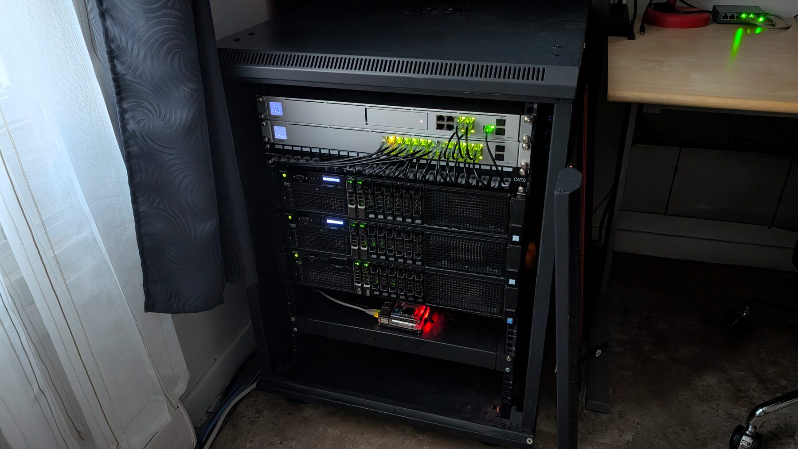
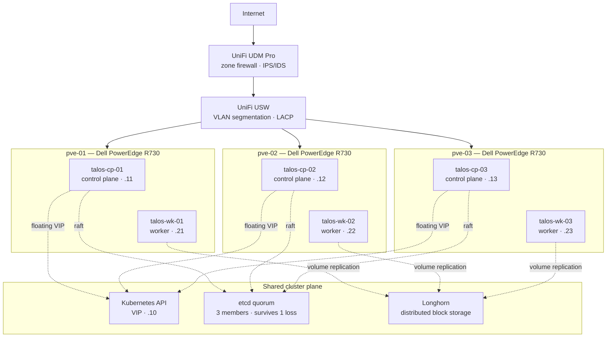
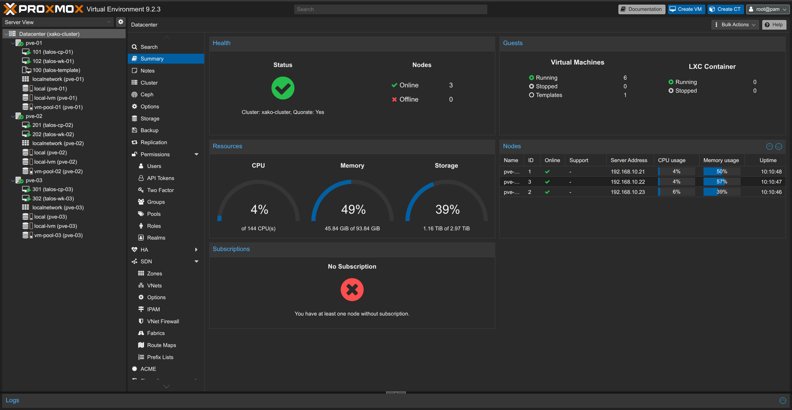
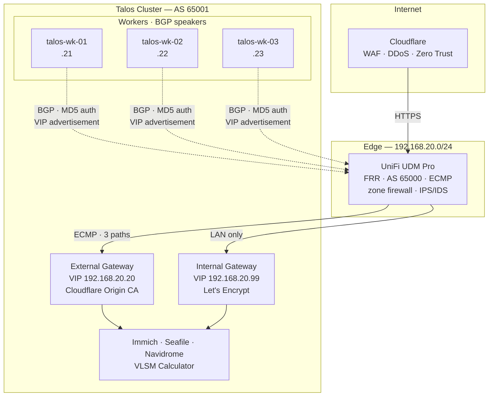
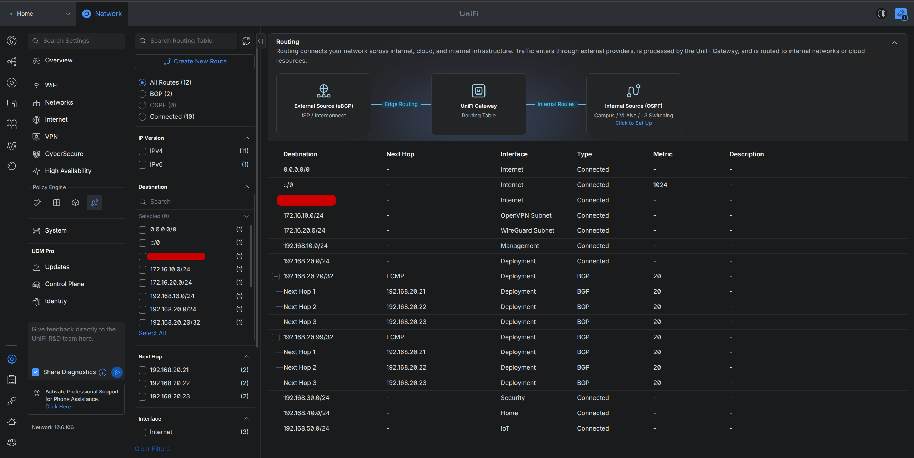
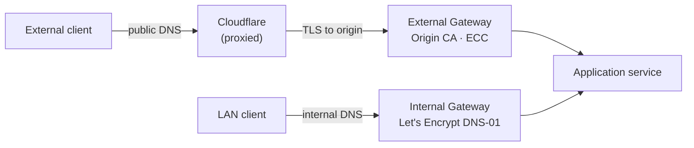
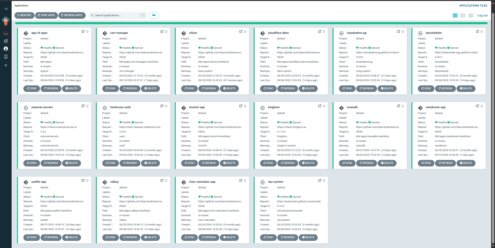
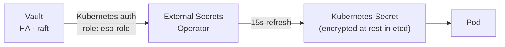
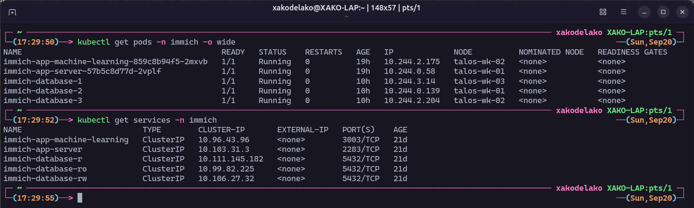

# 🏗️ Production Distributed Kubernetes Datacenter

<div align="center">

[](https://kubernetes.io/)
[](https://www.talos.dev/)
[](https://www.proxmox.com/)
[](https://helm.sh/)
[](https://cilium.io/)
[](https://frrouting.org/)
[](https://ui.com/)
[](https://www.cloudflare.com/)
[](https://argo-cd.readthedocs.io/)
[](https://longhorn.io/)
[](https://www.vaultproject.io/)

</div>

A production-grade, distributed Kubernetes datacenter architected from scratch — every component sourced individually — and deployed in a real 15U rack. Three Dell PowerEdge R730 hosts run Proxmox VE with Talos Linux in a redundant **3+3 topology**: one control-plane VM and one worker VM per physical host.

**This repository is the single source of truth.** Once the cluster is bootstrapped, a `git push` to `main` is the only deployment mechanism — no workload is ever deployed or changed with a manual `kubectl apply`.

🌐 **Live services:** [gallery.xako.net](https://gallery.xako.net) · [drive.xako.net](https://drive.xako.net) · [music.xako.net](https://music.xako.net) · [vlsm.xako.net](https://vlsm.xako.net)

---

## 📸 The Rack



---

## 🚀 About The Project

Every personal service I use — photo backup, file sync, music streaming, custom applications — runs on hardware I own, with **zero dependency on third-party service providers**. The only external pieces are the ones the edge itself relies on: DNS, DDoS protection and TLS issuance through Cloudflare and Let's Encrypt. That constraint drove every architectural decision in this repository.

The goal was not to make self-hosting work. It was to make it work the way production infrastructure works: declarative, reproducible, observable, and recoverable without a human typing commands into a terminal.

Four decisions define the build:

- 🧩 **Talos Linux** — an immutable, API-driven OS with no shell and no SSH. The attack surface of a node is its API, and nothing else.
- 🛰️ **BGP-routed VIPs instead of L2 announcements** — Cilium peers with the UniFi gateway so LoadBalancer VIPs are genuinely routed with ECMP, not owned by a single elected node.
- 🔀 **Split-horizon DNS with dual certificate authorities** — one hostname, two paths, and a publicly trusted certificate presented to every client.
- 🔐 **No secrets in Git, ever** — Vault HA + External Secrets Operator, verifiable across the entire commit history.

---

## 🖥️ Hardware & Edge

| Layer                   | Equipment                                                           |
| ----------------------- | ------------------------------------------------------------------- |
| **Rack**                | 15U, self-assembled                                                 |
| **Compute**             | 3 × Dell PowerEdge R730 running **Proxmox VE** in a quorate cluster |
| **Aggregate resources** | 144 CPU threads · 94 GiB RAM · 3 TiB storage                        |
| **Kubernetes nodes**    | 6 × **Talos Linux** VMs — 1 control plane + 1 worker per host       |
| **Gateway**             | **UniFi UDM Pro** — zone-based firewall, IPS/IDS, FRRouting         |
| **Switching**           | **UniFi USW** — VLAN segmentation, LACP link aggregation, PoE       |
| **Edge**                | **Cloudflare** — WAF, DDoS protection, proxied DNS, Zero Trust      |
| **Remote access**       | OpenVPN and WireGuard, each on its own routed subnet                |

### Network segmentation

Seven segments, separated by function rather than convenience, with zone-based firewall policies between them:

| Segment                             | Purpose                                                                 |
| ----------------------------------- | ----------------------------------------------------------------------- |
| `192.168.10.0/24`                   | **Management** — Proxmox hypervisors, switch and gateway administration |
| `192.168.20.0/24`                   | **Deployment** — Kubernetes nodes and advertised service VIPs           |
| `192.168.30.0/24`                   | **Security** — IP surveillance                                          |
| `192.168.40.0/24`                   | **Home** — personal devices                                             |
| `192.168.50.0/24`                   | **IoT** — untrusted appliances, isolated from everything else           |
| `172.16.10.0/24` · `172.16.20.0/24` | **Remote access** — OpenVPN and WireGuard                               |

The hypervisor management plane and the workload plane are deliberately separate: the Proxmox API is reachable only from the management segment, while everything Kubernetes exposes is routed on the deployment segment. Compromising a workload does not put an attacker on the same network as the hypervisors.

The 3+3 topology means losing an entire R730 leaves a **2/3 etcd quorum** and two live workers. ECMP on the gateway withdraws the dead path automatically when the BGP hold timer expires — roughly nine seconds, with no manual intervention.

Observability covers the physical and network layers — Proxmox host metrics, UniFi traffic flows, and a **smart plug tracking real-time power draw** of the rack. In-cluster metrics and alerting are next on the [roadmap](#-roadmap).





---

## 🗺️ Architecture



---

## 🛰️ Routed North-South Traffic with BGP

Workers — and **only** workers, enforced by a `nodeSelector` that excludes `node-role.kubernetes.io/control-plane` — establish BGP sessions with the UDM Pro. Cilium discovers its peer automatically, so the router's address is never hardcoded in a manifest.

```yaml
# k8s/apps/cilium/manifests/cilium.yaml
# Simplified excerpt — fields from CiliumBGPClusterConfig and CiliumBGPPeerConfig
localASN: 65001 # cluster
peerASN: 65000 # UDM Pro
autoDiscovery:
  mode: "DefaultGateway" # no hardcoded peer IP
timers:
  holdTimeSeconds: 9 # failure detected in ~9s
  keepAliveTimeSeconds: 3
gracefulRestart:
  enabled: true # traffic survives a Cilium agent restart
authSecretRef: bgp-auth-secret # MD5 key synced from Vault by ESO
```

On the router side, FRR accepts nothing but the two expected VIPs and advertises nothing back into the cluster:

```text
 address-family ipv4 unicast
  maximum-paths 3                        # ECMP across all three workers
  neighbor TALOS-WORKERS route-map TALOS-IN in
  neighbor TALOS-WORKERS route-map TALOS-OUT out
!
route-map TALOS-OUT deny 10              # cluster learns zero routes
ip prefix-list TALOS-LB-VIP seq 5 permit 192.168.20.20/32
ip prefix-list TALOS-LB-VIP seq 10 permit 192.168.20.99/32
```

> **Why replace L2 announcements?** L2 mode elects a single node to own a VIP: all traffic for that service funnels through one host, and failover depends on an ARP refresh clients may cache. With BGP, all three workers advertise the same VIP, the router load-balances across them with ECMP, and failure detection becomes a protocol timer rather than a cache expiry. `maximum-paths 3` is what makes the balancing real; the restrictive route-maps are what keep the trust boundary one-directional.



_Both gateway VIPs installed as BGP routes, each load-balanced across all three workers._

---

## 🔀 Split-Horizon DNS & Dual Certificate Authorities

Every `*.xako.net` hostname resolves differently depending on where you ask from — and every client is presented a valid, publicly trusted certificate either way. Both gateways listen on the `*.xako.net` wildcard, and each service's `HTTPRoute` attaches to both, so every service is reachable on both paths.



|                                    | External Gateway                               | Internal Gateway                                        |
| ---------------------------------- | ---------------------------------------------- | ------------------------------------------------------- |
| **VIP**                            | `192.168.20.20`                                | `192.168.20.99`                                         |
| **Issuer**                         | Cloudflare `ClusterOriginIssuer` (`OriginECC`) | Let's Encrypt `ClusterIssuer`, **DNS-01** challenge     |
| **Certificate seen by the client** | Cloudflare's edge certificate                  | Let's Encrypt certificate                               |
| **Path**                           | Internet → Cloudflare proxy → origin           | LAN only — routed by the UDM Pro, never touches the WAN |

The Origin CA certificate secures only the Cloudflare → origin leg and is trusted by Cloudflare alone; browsers never see it.

Two concrete wins:

1. **Local traffic stays local.** A 4 GB upload to Immich from home is routed by the UDM Pro straight to the internal gateway — no round trip through Cloudflare, no residential upstream bandwidth consumed.
2. **No certificate warnings internally.** A DNS-01 challenge issues a publicly trusted certificate for a service that only listens on a private IP — something HTTP-01 could never validate.

The public `A` record is kept current by `cloudflare-ddns` with `PROXIED=true`, which keeps the residential IP hidden behind Cloudflare's edge.

---

## 🚀 GitOps: App-of-Apps & Sync Waves

`k8s/root-app.yaml` defines the `app-of-apps` Application, which recursively discovers every `application.yaml` under `k8s/apps/`. Adding a service means adding a directory — nothing else. Every `Application` runs with `automated` sync, `prune`, and `selfHeal`, so manual drift is reverted automatically.

Install order is enforced with **sync waves**, because the dependencies are real:

| Wave | Components                                                          | Why here                                            |
| :--: | ------------------------------------------------------------------- | --------------------------------------------------- |
| `-5` | **ArgoCD** (itself)                                                 | The controller reconciling everything else          |
| `-4` | **Cilium**                                                          | Without a CNI, no pod schedules                     |
| `-3` | **Longhorn**                                                        | Vault's raft storage needs persistent volumes       |
| `-2` | **HashiCorp Vault** (HA, raft)                                      | Source of every secret downstream                   |
| `-1` | **External Secrets**, VPA, Descheduler                              | ESO must run before any `ExternalSecret` reconciles |
| `0`  | cert-manager, CloudNativePG, MariaDB, Valkey, DDNS, VLSM Calculator | Platform services and standalone apps               |
| `1`  | **Immich**                                                          | Depends on its PostgreSQL cluster                   |
| `3`  | **Seafile**                                                         | Depends on both MariaDB and Valkey                  |
| `4`  | **Navidrome**                                                       | Its sidecar syncs the music library from Seafile    |

The bootstrap itself — Cilium and ArgoCD, the only two components that cannot deploy themselves on an empty cluster — lives in `k8s/helmfile.yaml`, pinned to the same chart versions as their `Application`. From there, ArgoCD takes over both: Cilium (including its BGP and Gateway manifests) through `k8s/apps/cilium/`, and **ArgoCD manages its own upgrades** through `k8s/apps/argocd/`. After the first install, `helmfile` is never run again.



---

## 🔐 Secrets Management

**There are no secrets in this repository, and there never have been.** `.gitignore` has covered the generated Talos configs (`controlplane.yaml`, `worker.yaml`, `talosconfig`) since the initial commit — joined later by `secrets.yaml`, the cluster PKI — and no `kind: Secret` or `stringData` block appears anywhere in the history.



Each application declares an `ExternalSecret` pointing at the `vault-backend` `ClusterSecretStore`. What lives in Git is a **key name**, never a value. Once synced, the resulting `Secret` is stored in etcd, which Talos encrypts at rest.

```yaml
spec:
  secretStoreRef:
    name: vault-backend
    kind: ClusterSecretStore
  dataFrom:
    - extract:
        key: cloudflare # contents live in Vault, not here
```

The BGP session's MD5 key follows the same path on the cluster side. On the router side, `frr.conf` holds only the placeholder `#${SECRET}#`; the key itself is entered directly on the UDM Pro and never committed.

---

## 📦 Workloads

| Service                     | Purpose                                                                         | Notable implementation                                                                                                                                                                                        |
| --------------------------- | ------------------------------------------------------------------------------- | ------------------------------------------------------------------------------------------------------------------------------------------------------------------------------------------------------------- |
| **Immich**                  | Photo & video backup                                                            | PostgreSQL via CloudNativePG in a 3-instance cluster, with the **VectorChord** extension powering semantic search; VPA on both the server and the machine-learning deployment                                 |
| **Seafile**                 | File synchronization                                                            | 100 Gi on Longhorn, backed by MariaDB (three databases) with Valkey as cache                                                                                                                                  |
| **Navidrome**               | Music streaming                                                                 | A `seafile-client` **sidecar** syncs a Seafile library into the music PVC — upload a track from any device through Seafile, and Navidrome picks it up automatically                                           |
| **VLSM Calculator**         | Custom application ([repo](https://github.com/ilyas-bouktrane/vlsm-calculator)) | 3 replicas, `topologySpreadConstraints` across hosts, PDB `minAvailable: 1`, non-root with all capabilities dropped and `seccompProfile: RuntimeDefault`, liveness and readiness probes                       |
| **Valkey**                  | Cache layer                                                                     | 2 replicas, PDB, ACL-based authentication                                                                                                                                                                     |
| **CloudNativePG / MariaDB** | Stateful data                                                                   | CloudNativePG runs a 3-instance PostgreSQL cluster spread across workers; the MariaDB operator runs 3 replicas with pod anti-affinity and a PDB, while the database instance itself is single-replica for now |
| **VPA + Descheduler**       | Scheduling                                                                      | Automatic resource right-sizing, and hourly pod rebalancing across workers                                                                                                                                    |



---

## 📂 Project Structure

```text
/
├── 📁 talos/
│   ├── 📄 cp-patch.yaml         # Every control-plane customization on top of Talos defaults
│   ├── 📄 wk-patch.yaml         # Every worker customization on top of Talos defaults
│   └── 🔒 secrets.yaml, controlplane.yaml, worker.yaml, talosconfig   # gitignored, generated
│
├── 📄 frr.conf                  # BGP configuration applied on the UniFi UDM Pro
│
├── 📁 screenshots/              # Images used in this README
│
└── 📁 k8s/
    ├── 📄 helmfile.yaml         # Bootstrap only: Cilium + ArgoCD, pinned to their Application versions
    ├── 📄 root-app.yaml         # ArgoCD app-of-apps
    └── 📁 apps/<service>/
        ├── 📄 application.yaml  # ArgoCD Application — Helm sources + sync wave (ArgoCD included)
        └── 📁 manifests/        # Cluster-specific resources (routes, PVCs, ExternalSecrets)
```

---

## 🧭 Architecture Decisions

**Talos over a general-purpose distro.** No SSH, no shell, no package manager. Debugging has to go through `talosctl`, which forces the discipline of rebuilding a node rather than patching it by hand — the same discipline that makes the cluster reproducible.

**Talos configuration as patches, not files.** Only `talos/cp-patch.yaml` and `talos/wk-patch.yaml` are versioned: each one lists, in the Talos 1.14 multi-document format, every setting that differs from `talosctl gen config` defaults for its role. The full machine configs are build artifacts generated from those patches and `secrets.yaml`, so they can be thrown away and regenerated identically — and new Talos defaults are picked up on regeneration instead of being frozen in an old file. Nothing is node-specific: hostnames come from Proxmox cloud-init (the VM name), IPs from UniFi DHCP reservations, so one command configures every node of a role. The two patches are deliberately self-contained rather than sharing a common file, because control planes and workers are expected to diverge.

**Control planes don't speak BGP.** Excluding them from peering keeps data-plane traffic off the nodes carrying etcd.

**`longhorn-single` as the default StorageClass.** One replica with `dataLocality: strict-local` keeps volumes local to their pod: fast, with no replication traffic. It's a deliberate trade — real resilience comes from application-level replication (PostgreSQL running three instances) rather than from the block layer, and workloads needing block redundancy use the standard `longhorn` class explicitly.

**The migration is visible in the history.** The network was first managed by a TP-Link Omada controller, self-hosted in the cluster with MongoDB, before a full move to UniFi — then the cluster was reworked into the current split-horizon architecture. Debug commits weren't squashed away — the path is part of the record.

---

## 🚧 Roadmap

Honest infrastructure has a debt list. This one is mine:

- [x] **Pin image versions** — every Helm chart and third-party workload image now runs an explicit version instead of `:latest`
- [ ] **Pin the Talos bootstrap manifests** — `kubelet-serving-cert-approver` (`main`) and `metrics-server` (`latest`) are still fetched from floating URLs in the Talos patches
- [ ] **Version the VLSM Calculator image** — tag each build with its commit SHA so updates ship through Git like everything else
- [ ] **MariaDB Galera** — the operator runs HA, the database instance does not yet
- [ ] **Tighten Seafile grants** — currently broader than the three databases it actually needs
- [ ] **In-cluster observability** — Prometheus + Grafana with alerting on BGP session state and Longhorn volume health
- [ ] **Off-site backups** — Longhorn volume snapshots replicated to remote object storage
- [ ] **Cilium NetworkPolicies** — namespace-level isolation to complete the Zero-Trust posture

---

## 🔁 Reproducing the Cluster

This section rebuilds the cluster from bare hypervisors. Every step is either a command or a setting to enter; nothing relies on state that isn't described here.

### Versions this repository targets

| Component       | Version                                         | Where it is pinned                                      |
| --------------- | ----------------------------------------------- | ------------------------------------------------------- |
| Talos Linux     | **v1.14.6**                                     | installer image in `talos/cp-patch.yaml` / `wk-patch.yaml` |
| Kubernetes      | **v1.36.6**                                     | `--kubernetes-version` flag of `talosctl gen config`    |
| Cilium          | **1.20.5**                                      | `k8s/apps/cilium/application.yaml` + `k8s/helmfile.yaml` |
| ArgoCD          | **v3.6.2** (chart 10.18.2)                      | `k8s/apps/argocd/application.yaml` + `k8s/helmfile.yaml` |
| Gateway API     | **v1.7.0** (experimental channel)               | Talos bootstrap manifest in `talos/cp-patch.yaml`       |

Kubernetes is held at 1.36 on purpose: no released Cilium version is tested against 1.37 yet.

**Tools on the admin machine:** `talosctl` (same minor version as the nodes), `kubectl`, `helm`, `helmfile`.

### 1. Network (UniFi)

1. **Deployment VLAN** `192.168.20.0/24`, with DHCP reservations matching the VM MAC addresses:

   | Node          | IP              |
   | ------------- | --------------- |
   | `talos-cp-01` | `192.168.20.11` |
   | `talos-cp-02` | `192.168.20.12` |
   | `talos-cp-03` | `192.168.20.13` |
   | `talos-wk-01` | `192.168.20.21` |
   | `talos-wk-02` | `192.168.20.22` |
   | `talos-wk-03` | `192.168.20.23` |

   Keep `192.168.20.10` (Kubernetes API VIP), `192.168.20.20` (external gateway) and `192.168.20.99` (internal gateway) **outside** the DHCP pool.

2. **Zone firewall policies** — the admin machine's zone needs TCP **50000** (Talos API) and **6443** (Kubernetes API) towards the Deployment zone. Never allow the reverse direction.
3. **BGP** — apply [`frr.conf`](frr.conf) on the UDM Pro, replacing the `#${SECRET}#` placeholder with a random MD5 password. The same password goes into Vault at `secret/cilium-bgp` (step 6).
4. **Split-horizon DNS** — on the UDM, a local DNS record `*.xako.net → 192.168.20.99` (internal gateway). Public records are managed by `cloudflare-ddns` once the cluster runs.

### 2. Proxmox VMs

Download the Talos ISO built from this repository's [Image Factory](https://factory.talos.dev) schematic — nocloud platform, SecureBoot, extensions `iscsi-tools` (required by Longhorn), `qemu-guest-agent` and `util-linux-tools`:

```text
https://factory.talos.dev/image/861a91152157e97c900df9ca48fe4a26f19f19795e081386751bb7994c16800f/v1.14.6/nocloud-amd64-secureboot.iso
```

Create six VMs, one control plane and one worker per Proxmox host:

- **Name** = the Talos hostname (`talos-cp-01`, `talos-wk-01`, …) — Talos reads it from cloud-init, nothing else sets it.
- **Firmware**: OVMF (UEFI) with an EFI disk, **Secure Boot keys not pre-enrolled** (setup mode): at first boot, choose *Enroll Secure Boot keys* in the Talos boot menu.
- **Machine** `q35`, **disk** on a SCSI controller (it must appear as `/dev/sda`), **QEMU guest agent** enabled.
- **Cloud-Init drive** added, with `ipconfig0` set to `ip=dhcp` — this is what hands the VM name to Talos as its hostname.
- Network on the Deployment VLAN, with the MAC address used in the DHCP reservation.

Boot every VM from the ISO: they come up in **maintenance mode** with their reserved IP.

### 3. Talos

```bash
cd talos/

# Cluster PKI: generate it once and back it up OUTSIDE the cluster (password manager, encrypted USB).
# It is the only file that cannot be regenerated.
talosctl gen secrets -o secrets.yaml

# Full machine configs = Talos defaults + the versioned patches + the PKI (all three outputs are gitignored)
talosctl gen config xako-cluster https://192.168.20.10:6443 \
  --kubernetes-version 1.36.6 \
  --with-secrets secrets.yaml \
  --config-patch-control-plane @cp-patch.yaml \
  --config-patch-worker @wk-patch.yaml \
  --output-dir . --force

# Nodes in maintenance mode accept an unauthenticated first config (hence --insecure), one node per call
for ip in 192.168.20.11 192.168.20.12 192.168.20.13; do
  talosctl apply-config --insecure -n "$ip" --file controlplane.yaml
done
for ip in 192.168.20.21 192.168.20.22 192.168.20.23; do
  talosctl apply-config --insecure -n "$ip" --file worker.yaml
done
```

Each node installs Talos to `/dev/sda` and reboots. Then:

```bash
export TALOSCONFIG=$PWD/talosconfig
talosctl config endpoint 192.168.20.11 192.168.20.12 192.168.20.13

talosctl bootstrap -n 192.168.20.11             # creates etcd — run it once, on a single node
talosctl kubeconfig -n 192.168.20.11            # merges the cluster into ~/.kube/config
talosctl -n 192.168.20.11 etcd members          # expect 3 members after a few minutes
```

Nodes stay `NotReady` until a CNI is installed — that is expected. The Gateway API CRDs, `metrics-server`, `kubelet-serving-cert-approver` and the Cloudflare Origin CA CRDs are installed by Talos itself (they are bootstrap manifests in `cp-patch.yaml`), so they already exist when Cilium starts.

### 4. Bootstrap Cilium and ArgoCD

```bash
cd ..
helmfile -f k8s/helmfile.yaml apply     # waits until Cilium is up; nodes turn Ready
```

This is the only time `helmfile` runs. The releases are pinned to the same versions as their `Application`, which ArgoCD adopts in the next step.

### 5. Hand everything to ArgoCD

```bash
kubectl apply -f k8s/root-app.yaml
```

The app-of-apps discovers every `k8s/apps/*/application.yaml` and installs them wave by wave. Vault comes up at wave `-2`, but **sealed**: everything that consumes a secret stays `Degraded` until step 6 is done. That is expected.

ArgoCD UI, while waiting:

```bash
kubectl -n argocd get secret argocd-initial-admin-secret -o jsonpath='{.data.password}' | base64 -d; echo
kubectl -n argocd port-forward svc/argocd-server 8080:443      # https://localhost:8080, user "admin"
```

### 6. Vault

**Initialize, unseal and join the three Raft members.** Store the unseal keys and the root token outside the cluster.

```bash
kubectl -n vault exec -ti hashicorp-vault-0 -- vault operator init -key-shares=5 -key-threshold=3
kubectl -n vault exec -ti hashicorp-vault-0 -- vault operator unseal      # repeat with 3 different keys

for i in 1 2; do
  kubectl -n vault exec -ti hashicorp-vault-$i -- vault operator raft join http://hashicorp-vault-0.hashicorp-vault-internal:8200
  kubectl -n vault exec -ti hashicorp-vault-$i -- vault operator unseal   # repeat with 3 keys
done
```

**Configure the secrets engine and the External Secrets role** (from a shell in `hashicorp-vault-0`, after `vault login <root-token>`):

```bash
vault secrets enable -path=secret kv-v2
vault auth enable kubernetes
vault write auth/kubernetes/config kubernetes_host=https://kubernetes.default.svc:443

vault policy write eso-policy - <<'EOF'
path "secret/data/*"     { capabilities = ["read"] }
path "secret/metadata/*" { capabilities = ["read", "list"] }
EOF

vault write auth/kubernetes/role/eso-role \
  bound_service_account_names=external-secrets \
  bound_service_account_namespaces=external-secrets \
  policies=eso-policy ttl=1h
```

**Write the secrets.** Every `ExternalSecret` reads one Vault path and expects exactly these keys:

| Vault path (`vault kv put secret/<path> …`) | Keys                                                                                                                         | Consumed by                                          |
| ------------------------------------------- | ---------------------------------------------------------------------------------------------------------------------------- | ---------------------------------------------------- |
| `cloudflare`                                | `cfapi-ca-token` (Origin CA), `cfapi-dns-zone-token` (DNS edit, Let's Encrypt DNS-01), `cfapi-ddns-token` (DNS edit)          | cert-manager issuers, `cloudflare-ddns`              |
| `cilium-bgp`                                | `password` — the MD5 password configured in `frr.conf`                                                                       | Cilium BGP peering                                   |
| `argocd`                                    | `username`, `password` — a GitHub read-only token for this repository                                                         | ArgoCD repository credentials                        |
| `valkey`                                    | `default` — password of the Valkey `default` ACL user                                                                        | Valkey                                               |
| `immich`                                    | `REDIS_PASSWORD` — same value as `valkey/default`                                                                            | Immich                                               |
| `cloudnative-pg/immich-user`                | `username` (`immich-user`), `password`                                                                                       | Immich PostgreSQL role                               |
| `mariadb`                                   | `root-password`, `seafile-password`                                                                                          | MariaDB                                              |
| `seafile`                                   | `INIT_SEAFILE_ADMIN_PASSWORD`, `INIT_SEAFILE_MYSQL_ROOT_PASSWORD` (= `mariadb/root-password`), `SEAFILE_MYSQL_DB_PASSWORD` (= `mariadb/seafile-password`), `REDIS_PASSWORD` (= `valkey/default`), `JWT_PRIVATE_KEY` (random 40+ characters) | Seafile |
| `seafile-client`                            | `SEAF_USERNAME`, `SEAF_PASSWORD` — a Seafile account owning the music library                                                 | Navidrome sync sidecar                               |

ESO polls every 15 seconds: within a minute, every `ExternalSecret` turns `Ready` and the remaining applications converge. The cluster is complete when ArgoCD shows every application `Synced` and `Healthy`:

```bash
kubectl -n argocd get applications
kubectl get ciliumbgpnodeconfigs -o wide      # one established session per worker
kubectl get gateway -A                        # both gateways Programmed, on .20 and .99
```

### 7. Last manual step: the Navidrome library

Navidrome syncs one Seafile library, referenced by ID. After logging into Seafile with the `seafile-client` account, create the music library and put its ID in `SEAF_LIBRARY` in `k8s/apps/navidrome/manifests/navidrome.yaml`, then push.

### Day-2 operations

**Changing the Talos configuration** — edit `cp-patch.yaml` or `wk-patch.yaml`, regenerate with the `gen config` command of step 3 (same `secrets.yaml`, same `--kubernetes-version`), preview, then apply one node at a time:

```bash
talosctl -n 192.168.20.11 apply-config --dry-run --file talos/controlplane.yaml
talosctl -n 192.168.20.11 apply-config --file talos/controlplane.yaml
```

Never regenerate without `--with-secrets`: a new PKI would break trust between the nodes.

**Upgrading Talos** — bump the installer tag in both patches, then upgrade the control planes one by one (`talosctl -n <ip> upgrade --image <installer-image>`), checking `etcd members` between each. Workers need more care, because every worker holds single-replica Longhorn volumes and a sealed-after-reboot Vault pod:

1. Relax Longhorn's drain policy for the duration of the operation:
   `kubectl -n longhorn-system patch settings.longhorn.io node-drain-policy --type merge -p '{"value":"allow-if-replica-is-stopped"}'`
2. Per worker: `talosctl upgrade --image <installer-image> --no-reboot` (stages the new version), then `kubectl drain <node> --ignore-daemonsets --delete-emptydir-data`, then `talosctl -n <ip> reboot`, then `kubectl uncordon <node>`. `talosctl upgrade` cannot drain a worker by itself, since only control planes expose a kubeconfig.
3. Unseal the Vault pod of that worker, and wait for every Longhorn volume to be `healthy` again before the next worker. Move the CloudNativePG primary away first if it runs there: `kubectl cnpg promote immich-database <instance> -n immich`.
4. Restore the policy: `block-if-contains-last-replica`.

**Upgrading Kubernetes** — `talosctl -n 192.168.20.11 upgrade-k8s --to <version> --dry-run`, then without `--dry-run`. One minor version at a time, and only to a version the current Cilium release is tested against. Afterwards, update `--kubernetes-version` in the `gen config` command.

**Upgrading any workload** — change its `targetRevision` (or image tag) in `k8s/apps/<service>/`, commit, push. ArgoCD itself is upgraded the same way, through `k8s/apps/argocd/application.yaml`; keep `k8s/helmfile.yaml` in sync for the next bootstrap.

---

## 👨‍💻 Contact

Built by **Ilyas Bouktrane** — Computer Science Technology student.

[](https://linkedin.com/in/ilyas-bouktrane)
[](https://github.com/ilyas-bouktrane)

Feel free to reach out with any questions or opportunities!
